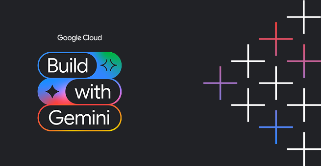

# Card Collector

Card Collector is a chat companion for a catalog of collectible creature cards. A Gemini agent (`gemini-2.5-flash` on the [Agent Development Kit](https://google.github.io/adk-docs/)) lists, fetches, adds, and updates cards in a Firestore `cards` collection, draws a three-card booster from that catalog, looks up creature stats on the public PokéAPI, and generates card artwork and a short card video that it uploads to Cloud Storage. The chat page shows plain-text replies and [A2UI](https://adk.dev/integrations/a2ui/) cards.

**Demo:** [demo_video.mp4](demo_video.mp4)

**Live app:** [card-collector-frontend-689344436861.us-east1.run.app](https://card-collector-frontend-689344436861.us-east1.run.app) (recorded in [`card-collector/README.md`](card-collector/README.md))

## Key features

- **Card catalog.** `list_cards` filters the Firestore `cards` collection by element (`Fire`, `Water`, `Earth`, `Electric`, `Dark`, `Wind`, `Nature`, `Cosmic`) and rarity (`Common`, `Uncommon`, `Rare`, `Epic`, `Legendary`, `Mythic`). `get_card` loads one card by document id or name (`hp`, `attack`, `defense`, `speed`, ability, price, description). `add_card` inserts a card. `update_card` changes `price`, `in_stock`, or `ability`.
- **Booster packs.** `open_booster_pack` draws three random cards from the catalog (fewer when the catalog is smaller) and returns them with the requested `pack_type` label.
- **External creatures.** `lookup_external_creature` reads stats, types, abilities, height, weight, and official artwork from [PokéAPI](https://pokeapi.co/).
- **Artwork and video.** `generate_card_artwork` calls Vertex AI `gemini-3.1-flash-lite-image`, saves an ADK artifact when a tool context is present, and uploads a JPEG to bucket `snap-tcg-cards-b661fd`. `generate_card_video` calls `gemini-omni-flash-preview` and uploads an MP4 to the same bucket.
- **Rich replies.** An after-model callback (`a2ui_callback`) turns A2UI v0.8 JSON into cards the dev UI and the chat page can render (`Card`, `Column`, `Row`, `Text`, `Divider`, `Image`).
- **Chat page.** `card-collector/frontend` is a FastAPI proxy and a static page. The document title is `🎴 Card Collector — TCG AI Companion`. The browser talks only to the proxy; the proxy sends messages to the deployed agent over A2A. Prompt chips open a booster, browse rare cards, generate artwork, and generate a card video.
- **Memory hooks.** The agent registers `PreloadMemoryTool` and an after-agent callback that calls `add_session_to_memory`. Local sessions use the in-memory session service. Set `SESSION_SERVICE_URI`, or `GOOGLE_CLOUD_AGENT_ENGINE_ID` with `GOOGLE_CLOUD_PROJECT`, to select another session backend (`app/app_utils/services.py`).

`card-collector/seed_firestore.py` can load the sample catalog (Ignis Drake, Aqua Siren, and the other creatures in that file) into Firestore project `qwiklabs-gcp-04-b661fd22d876`.

## Tech stack

| Piece | What this repo uses |
| --- | --- |
| Language | Python `>=3.11,<3.14` (`card-collector/pyproject.toml`) |
| Agent | Google ADK (`google-adk`), model `gemini-2.5-flash` |
| Agent server | FastAPI and uvicorn (`card-collector/app/fast_api_app.py`), A2A routes |
| Catalog | Cloud Firestore collection `cards` |
| Media | Cloud Storage bucket `snap-tcg-cards-b661fd` |
| Image and video models | `gemini-3.1-flash-lite-image`, `gemini-omni-flash-preview` |
| Rich UI | `a2ui-agent-sdk` (A2UI v0.8) |
| Chat frontend | FastAPI, `a2a-sdk`, and static HTML in `card-collector/frontend` |
| Packages | `uv` with `card-collector/uv.lock` (the agent image installs `uv==0.8.13`) |
| Deploy target | Agent Runtime in `us-east1`, A2A enabled (`card-collector/agents-cli-manifest.yaml`, `card-collector/deployment_metadata.json`) |

Firestore, Cloud Storage, and the image and video calls use project `qwiklabs-gcp-04-b661fd22d876`, hardcoded in `card-collector/app/agent.py`. The deployed reasoning engine id is `projects/689344436861/locations/us-east1/reasoningEngines/5848463976349827072`.

## Run it locally

### Agent

Install locked dependencies and start the server the same way the agent image does (`card-collector/Dockerfile`):

```bash
cd card-collector
uv sync --frozen
uv run uvicorn app.fast_api_app:app --host 0.0.0.0 --port 8080
```

`app/fast_api_app.py` calls `load_dotenv()`, so copy [`card-collector/.env.example`](card-collector/.env.example) to `card-collector/.env`. That file is the Vertex AI setup, which is also what `tests/integration/test_server_e2e.py` exports:

```bash
GOOGLE_GENAI_USE_VERTEXAI=true
GOOGLE_CLOUD_PROJECT=your-gcp-project-id
GOOGLE_CLOUD_LOCATION=global
```

To call Gemini through AI Studio instead, comment out those three lines and set the key shown in the same example file:

```bash
GEMINI_API_KEY=your-api-key-here
```

Catalog and media tools use Application Default Credentials against the hardcoded project id above. `tests/integration/test_server_e2e.py` starts the same app on port 8000:

```bash
python -m uvicorn app.fast_api_app:app --host 0.0.0.0 --port 8000
```

Seed the sample catalog (same project id as `seed_firestore.py`):

```bash
uv run python seed_firestore.py
```

The agent server also reads these variables. Leave them unset for a local in-memory session:

| Variable | Read in | Effect |
| --- | --- | --- |
| `APP_URL` | `app/app_utils/a2a.py` | URL advertised on the A2A agent card |
| `ALLOW_ORIGINS` | `app/fast_api_app.py` | Comma-separated CORS origins |
| `GOOGLE_CLOUD_AGENT_ENGINE_ENABLE_TELEMETRY` | `app/fast_api_app.py` | `true` or `1` exports traces |
| `SESSION_SERVICE_URI` | `app/app_utils/services.py` | Session backend URI |
| `GOOGLE_CLOUD_AGENT_ENGINE_ID` | `app/app_utils/services.py`, `app/app_utils/a2a.py` | Vertex AI sessions, and the engine id used to build the card URL |
| `GOOGLE_CLOUD_AGENT_ENGINE_LOCATION` | `app/app_utils/services.py`, `app/app_utils/a2a.py` | Agent engine region (`us-east1` when unset for the card URL) |
| `LOGS_BUCKET_NAME` | `app/app_utils/services.py` | Cloud Storage bucket for artifacts |
| `AGENT_VERSION` | `app/app_utils/a2a.py` | Version on the agent card (default `0.1.0`; the image also sets it from a build arg) |

### Chat frontend

From `card-collector/frontend`, install `requirements.txt` and start `main.py` (the run steps in that file). Defaults for `AGENT_ENGINE_RESOURCE_NAME`, `AGENT_DIRECTORY` (`app`), and `PORT` (`8080`) are in `frontend/main.py`. The process uses Application Default Credentials to call the deployed agent.

```bash
cd card-collector/frontend
pip install -r requirements.txt
python main.py
```

Open `http://localhost:8080`. Override the defaults with:

```bash
export AGENT_ENGINE_RESOURCE_NAME="projects/689344436861/locations/us-east1/reasoningEngines/5848463976349827072"
export AGENT_DIRECTORY="app"
export PORT=8080
```

`AGENT_DIRECTORY` matches `agent_directory` in `card-collector/agents-cli-manifest.yaml`. The frontend image runs the same app with `uvicorn main:app --host 0.0.0.0 --port 8080` (`card-collector/frontend/Dockerfile`).

---

## About the Track 3 starter kit

The sections below are the Build with Gemini Track 3 starter kit and project gallery this repo was cloned from.

<div align="center">



# 🚀 Build with Gemini · Track 3

### The starter kit for Track 3 of the Build with Gemini World Tour, and a showcase of what participants built with it.

Clone this repo, open [Antigravity](https://antigravity.google), and build your own agent-first app on Google Cloud. Every project in the [gallery below](#-featured-projects) was built the same way: prototyped with Antigravity and `agents-cli`, equipped with Memory, tools, and storage, deployed to Agent Platform, and given a face on Cloud Run.

<br/>


<sub>📖 <a href="https://cszhu.github.io/build-with-gemini/">Lab Guide</a> · 🛠️ <a href="https://google.github.io/agents-cli/guide/getting-started/">agents-cli</a> · 🤖 <a href="https://google.github.io/adk-docs/">ADK</a></sub>

</div>

---

## 📚 Table of Contents

- [🧩 Anatomy of a Track 3 Project](#-anatomy-of-a-track-3-project)
- [📂 Featured Projects](#-featured-projects)
  - [🛍️ Commerce & Marketplace Agents](#️-commerce--marketplace-agents)
  - [🍳 Food & Recipe Agents](#-food--recipe-agents)
  - [✈️ Travel & Local Agents](#️-travel--local-agents)
  - [💪 Health, Fitness & Wellness Agents](#-health-fitness--wellness-agents)
  - [📚 Learning & Knowledge Agents](#-learning--knowledge-agents)
  - [🎨 Creative & Media Agents](#-creative--media-agents)
  - [🏢 Productivity & Enterprise Agents](#-productivity--enterprise-agents)
  - [🧪 Experimental & Other](#-experimental--other)
- [🧠 What's in this Repo](#-whats-in-this-repo)
- [🧰 Build Your Own](#-build-your-own)
- [📚 Resources](#-resources)
- [🤝 Contributing](#-contributing)
- [📄 License](#-license)

---

## 🧩 Anatomy of a Track 3 Project

Every app in this collection is built from the same set of Google Cloud building blocks introduced in the lab. Once you understand this shape, you can read any project here at a glance:

| Layer | What it does | Powered by |
|---|---|---|
| 🤖 **The Agent** | The core reasoning loop | [ADK](https://google.github.io/adk-docs/) + [`agents-cli`](https://google.github.io/agents-cli/guide/getting-started/), scaffolded with [Antigravity](https://antigravity.google) |
| 🧠 **Memory** | Remembers facts across sessions | [Agent Platform Memory Bank](https://docs.cloud.google.com/gemini-enterprise-agent-platform/scale/memory-bank) |
| 🗄️ **Structured data** | Inventory, records, lists | [Firestore](https://console.cloud.google.com/firestore) |
| 🖼️ **Files & blobs** | Images, media, assets | [Cloud Storage](https://console.cloud.google.com/storage) |
| 🔧 **Tools** | Take real actions and fetch real data | ADK function tools |
| 🎨 **Media generation** | Creates images (and video) on demand | `gemini-3.1-flash-lite-image` (Nano Banana 2 Lite) · Omni (video) |
| 🧪 **Code sandbox** | Safely runs generated code | Agent Platform code execution |
| 🪟 **Agent-first UI** | Cards and tables instead of plain text | [A2UI](https://adk.dev/integrations/a2ui/) |
| 🌐 **Frontend** | A shareable web face | FastAPI proxy on [Cloud Run](https://cloud.google.com/run) |

---

## 📂 Featured Projects

A showcase of what workshop participants built with this lab. Entries are added here from the swag and gallery submission form after each event, so the categories below start empty and fill in over time. Browse them for inspiration, or [submit your own](#-contributing) once you've published your project with the `publish-to-github` skill.

<!--
Add one entry per project, in this format:
- 🌿 **[Project Name](https://github.com/their-handle/their-repo)**: one-line description of what it does. <br/> <sub>by [@handle](https://github.com/handle)</sub>

Bump the "Projects" badge count at the top when you add one.
-->

### 🛍️ Commerce & Marketplace Agents

### 🍳 Food & Recipe Agents

- 🥫 **[Smart Pantry Recipe Concierge](https://github.com/matthewrose/buildwithgemini-smart-pantry-recipe-concierge)**: Tracks your pantry and recommends recipes grounded in a real recipe corpus. <br/> <sub>by [@matthewrose](https://github.com/matthewrose)</sub>

### ✈️ Travel & Local Agents

- ⛈️ **[SafeStageWX](https://github.com/felix1028/buildwithgemini-safestagewx)**: An agentic mobile app that helps event planners identify weather threats and climate risks for an event given its date and location, providing tailored preparedness timelines from months out down to hourly day-of forecasts. <br/> <sub>by [@felix1028](https://github.com/felix1028)</sub>
- 🌇 **[Sidewalk & Sun](https://github.com/OlafHaalstra/buildwithgemini-sidewalk-and-sun)**: Recommends sunny or shaded NYC spots from a curated 500-venue corpus, plotted on an interactive map. <br/> <sub>by [@OlafHaalstra](https://github.com/OlafHaalstra)</sub>

### 💪 Health, Fitness & Wellness Agents

- 🏊 **[TriCoach AI](https://github.com/common-aman/buildwithgemini-tricoach-ai)**: A triathlon coach that logs workouts, computes training zones, and generates motivational visuals. <br/> <sub>by [@common-aman](https://github.com/common-aman)</sub>

### 📚 Learning & Knowledge Agents

- 🎤 **[Interview Coach (PrepPal)](https://github.com/VineethBaradi/buildwithgemini-interview-coach)**: A mock-interview coach that runs LLM-driven practice sessions from a Firestore question bank and gives performance feedback. <br/> <sub>by [@VineethBaradi](https://github.com/VineethBaradi)</sub>

### 🎨 Creative & Media Agents

### 🏢 Productivity & Enterprise Agents

- 🔧 **[GitCraft](https://github.com/fpobletemu/buildwithgemini-gitcraft)**: A developer git assistant that inspects your repo and drafts Conventional-Commits-style messages, grounded in a commit-style guide. <br/> <sub>by [@fpobletemu](https://github.com/fpobletemu)</sub>
- 🖥️ **[IT Helpdesk Agent](https://github.com/NaweedAhmadi/buildwithgemini-it-helpdesk-agent)**: An IT support assistant that answers from a knowledge base and remembers context across sessions, with a ticket dashboard UI. <br/> <sub>by [@NaweedAhmadi](https://github.com/NaweedAhmadi)</sub>

### 🧪 Experimental & Other

- 🃏 **[Poker Agent](https://github.com/jakecho1108/buildwithgemini-poker-agent)**: A poker trainer with a real 800-iteration Monte Carlo equity engine and strategy tips grounded in a poker playbook. <br/> <sub>by [@jakecho1108](https://github.com/jakecho1108)</sub>

---

## 🧠 What's in this Repo

The `.agents/` folder teaches Antigravity how to build agents on Google Cloud.

### Skills

A **skill** is a bundle of instructions that loads automatically when it's relevant, so the agent gets the workflow right in fewer steps instead of rediscovering it each time.

| Skill | What it does |
| --- | --- |
| [`pick-your-agent-project`](.agents/skills/pick-your-agent-project/SKILL.md) | Brainstorm your app idea and write a project brief |
| [`troubleshoot-lab-setup`](.agents/skills/troubleshoot-lab-setup/SKILL.md) | Verify your environment and fix common setup errors |
| [`memory-bank-setup`](.agents/skills/setup-memory-bank/SKILL.md) | Add cross-session memory to your agent with Vertex AI Memory Bank |
| [`enable-a2ui`](.agents/skills/enable-a2ui/SKILL.md) | Make your agent reply with rich UI cards (A2UI) in the ADK dev UI |
| [`build-agent-frontend`](.agents/skills/build-agent-frontend/SKILL.md) | Generate a FastAPI chat frontend and ship it to Cloud Run |
| [`record-demo`](.agents/skills/record-demo/SKILL.md) | Record a branded demo video of your agent, with an optional AI soundtrack |
| [`publish-to-github`](.agents/skills/publish-to-github/SKILL.md) | Publish your finished project to your own GitHub and submit it for swag |

### Pre-configured tools (MCP)

[`.agents/mcp_config.json`](.agents/mcp_config.json) wires up two [Model Context Protocol](https://modelcontextprotocol.io/) servers that authenticate with your gcloud credentials, so the agent can look things up instead of guessing:

- **Firebase**: work directly with Firestore and other Firebase services
- **Google Developer Knowledge**: grounded access to Google's official docs (Cloud, Firebase, ADK, Agent Platform)

### Layout

```text
.agents/
├── mcp_config.json    # Firebase + Developer Knowledge MCP servers
├── rules/             # workspace rules (only deploy when asked)
└── skills/            # the workshop skills listed above
```

---

## 🧰 Build Your Own

The full, step-by-step walkthrough lives on the **[lab guide](https://cszhu.github.io/build-with-gemini/)**. This is the short version.

**Prerequisites** (the lab workstation comes with all of this pre-installed; you'll need it if you're running on your own machine):

- A **Google Cloud project** with billing enabled
- **[Antigravity](https://antigravity.google)** (`agy`), the coding agent that loads the skills above
- **[agents-cli](https://google.github.io/agents-cli/guide/getting-started/)**, built on the [Agent Development Kit (ADK)](https://google.github.io/adk-docs/)
- Authenticated gcloud: `gcloud auth login` and `gcloud auth application-default login`
- A personal **GitHub account** for the final publish-and-submit step

**Quickstart:**

```bash
git clone https://github.com/cszhu/build-with-gemini
cd build-with-gemini
agy
```

On startup, Antigravity scans the `.agents/` folder and loads the skills and tools above automatically. In the AGY prompt:

```text
/skills            # see the installed skills
/mcp               # confirm the firebase + google-developer-knowledge tools are connected
```

```text
Verify my setup.   # runs the troubleshoot-lab-setup skill to check your environment
```

Then follow the [lab guide](https://cszhu.github.io/build-with-gemini/) to design, build, deploy, and share your agent, start to finish.

---

## 📚 Resources

- **[Lab guide](https://cszhu.github.io/build-with-gemini/)**: the step-by-step workshop
- [Antigravity](https://antigravity.google)
- [agents-cli](https://google.github.io/agents-cli/guide/getting-started/)
- [Agent Development Kit (ADK)](https://google.github.io/adk-docs/)
- [Gemini Enterprise Agent Platform](https://docs.cloud.google.com/gemini-enterprise-agent-platform)

---

## 🤝 Contributing

**Built something?** Publish it with the `publish-to-github` skill and submit it through the form it gives you. Submissions get you swag, and standout projects get added to the [Featured Projects](#-featured-projects) gallery above.

**Found a bug?** If you hit a rough edge in a skill or the lab, please [open an issue](https://github.com/cszhu/build-with-gemini/issues).

---

## 📄 License

This is not an officially supported Google product and is provided for the Build with Gemini workshop for demonstration purposes only.
